# Active Directory IAM Lab — MOVER
### Employee Role Change | Access Modification | Least-Privilege Validation


## Project Overview
This project demonstrates the **Mover** stage of the IAM lifecycle: updating a simulated employee's access when their job responsibilities change. I reviewed **Sarah Williams's** Finance account and role, configured and verified group-based access, and tested file operations on the Finance SMB share. I also checked that a read-only user still could not modify a protected report.

**Employee:** Sarah Williams (`sarah.williams`)  
**Business change:** Finance role requiring write access  
**Domain:** `myshitbox.com` (lab)  
**Environment:** Azure-hosted Windows Server DC-1, Windows client VM, ADUC, PowerShell, NTFS and SMB  
**Resource:** `\\DC-1\Finance`  
**Relevant groups:** `GG_FINANCE_READONLY`, `GG_FINANCE_READWRITE`

> **Lab disclaimer:** The identities and company resources in this project are simulated.

## Business Scenario
A Finance employee's responsibilities change. The IAM administrator must review the employee's role, ensure membership in the correct access group, verify that share and NTFS permissions permit the intended operations, and ensure other employees do not receive unnecessary access.

## Access Design
| Group | SMB share permission | Intended file-system permission |
|---|---|---|
| `GG_FINANCE_READONLY` | Read | Read & Execute |
| `GG_FINANCE_READWRITE` | Change | Modify |

**Important:** Windows file access depends on the combined effect of share permissions and NTFS permissions. Membership alone does not guarantee successful access.

## Implementation & Screenshot Evidence

### 1. Review Sarah's account and group membership
I used ADUC to inspect Sarah's security group assignments and employee attributes.

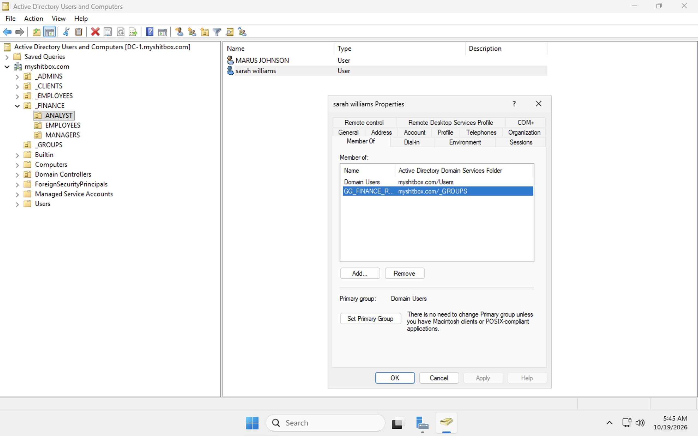
*Figure 1 — Sarah Williams's group membership.*

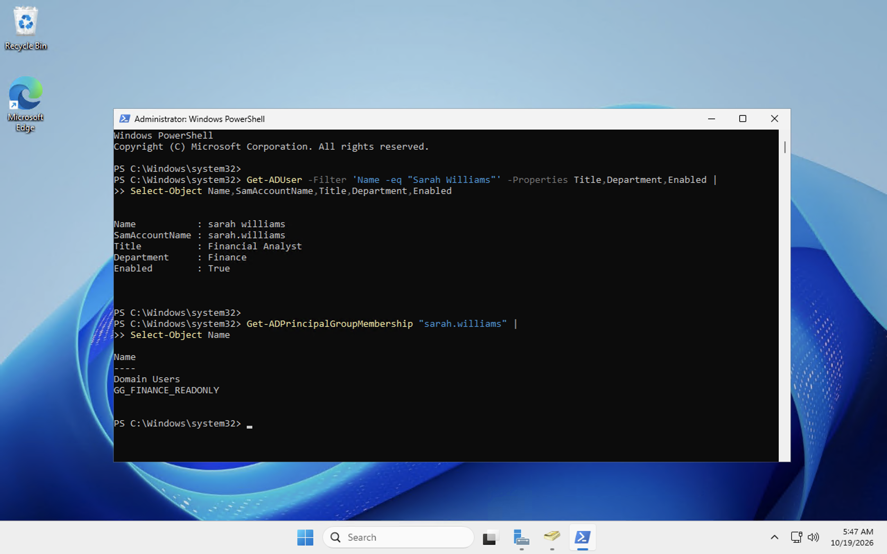
*Figure 2 — Account and group checks in PowerShell.*

```powershell
Get-ADUser -Identity "sarah.williams" -Properties Department,Title,Enabled |
    Select-Object Name,SamAccountName,Department,Title,Enabled

Get-ADPrincipalGroupMembership "sarah.williams" |
    Select-Object Name
```

### 2. Compare read-only access
A separate read-only test established that the protected Finance report could not be saved without write access.

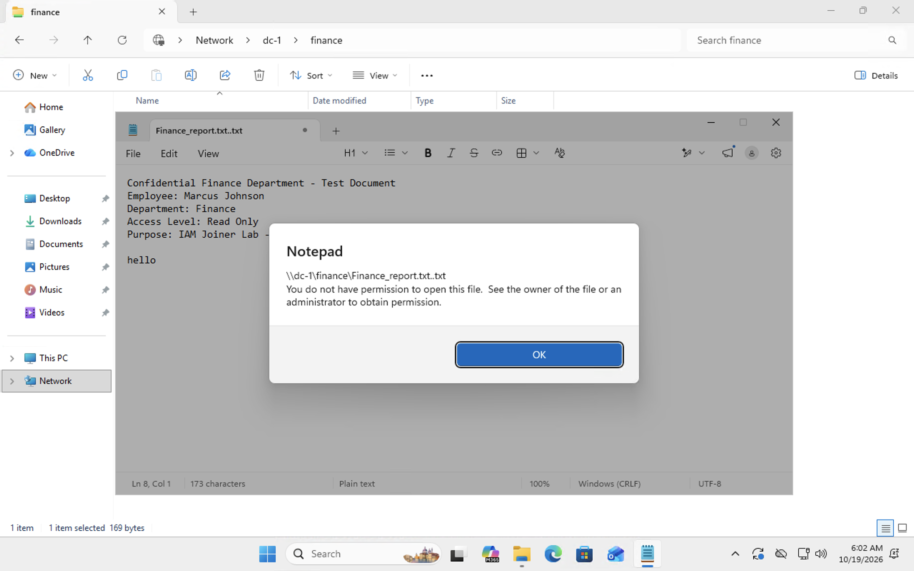
*Figure 3 — Access-denied comparison test.*

### 3. Review role information and departmental groups
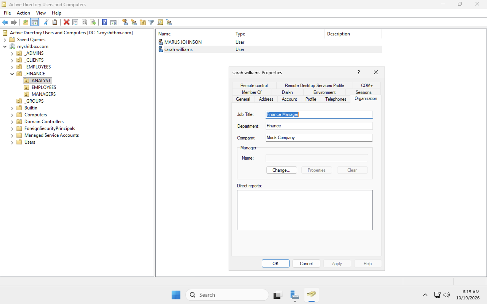
*Figure 4 — Sarah's updated job-title field.*

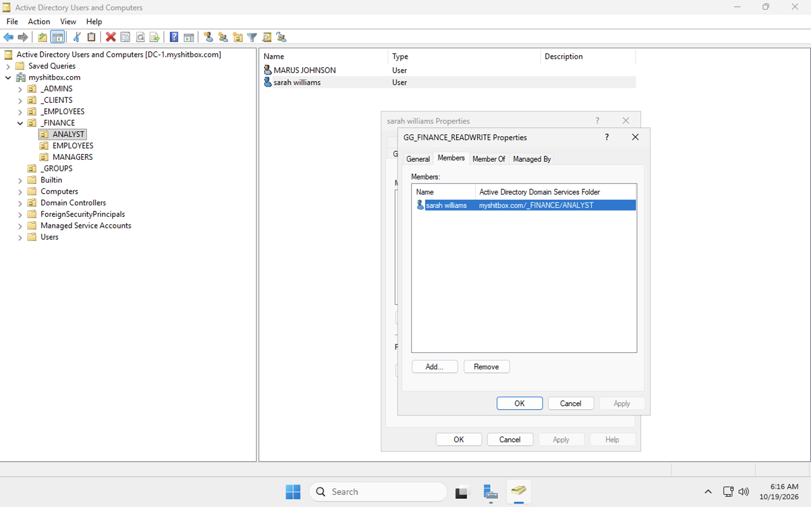
*Figure 5 — Finance read-only group reviewed in ADUC.*

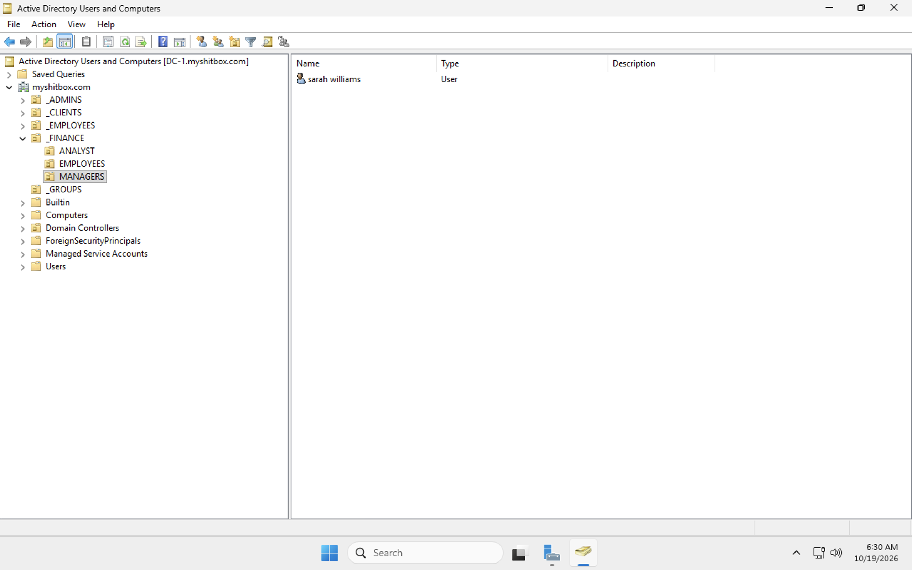
*Figure 6 — Finance organizational structure.*

### 4. Validate write access on the Finance share
Using the Windows client, I confirmed that Sarah could work with a test file in the Finance shared folder.


*Figure 7 — Manager test file visible in the share.*

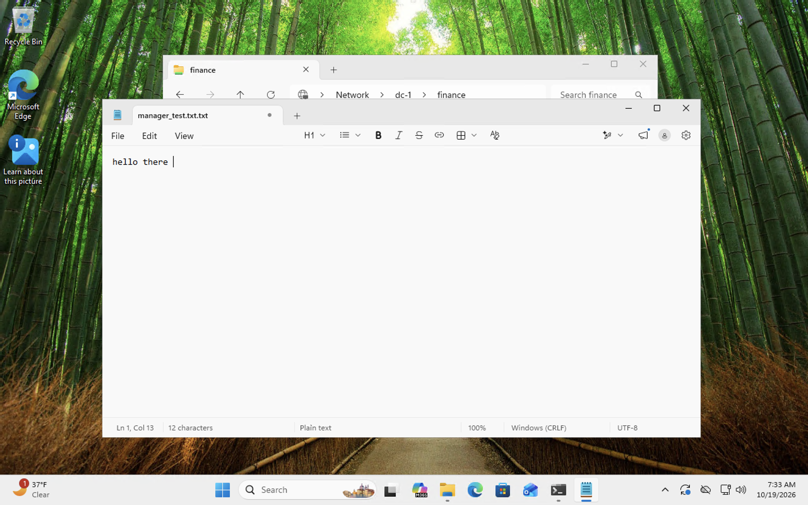
*Figure 8 — Manager test file opened in Notepad.*

### 5. Inspect SMB access and validate file operations
```powershell
Get-SmbShareAccess -Name "Finance"
```

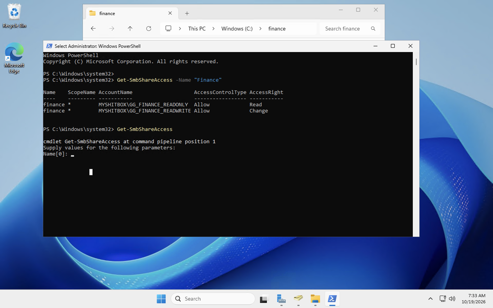
*Figure 9 — Finance share access shows separate Read and Change permissions.*

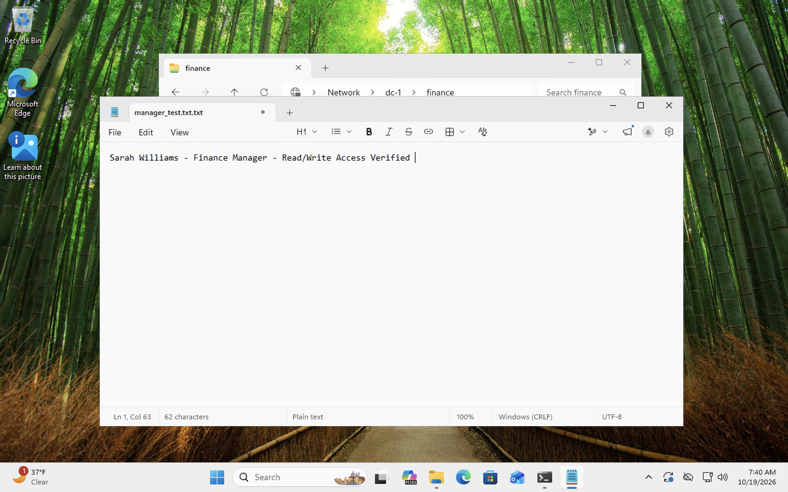
*Figure 10 — Editing the manager test file.*

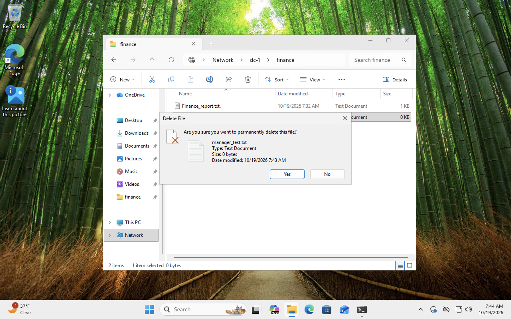
*Figure 11 — Delete confirmation shown during cleanup; the prompt itself does not prove deletion succeeded.*

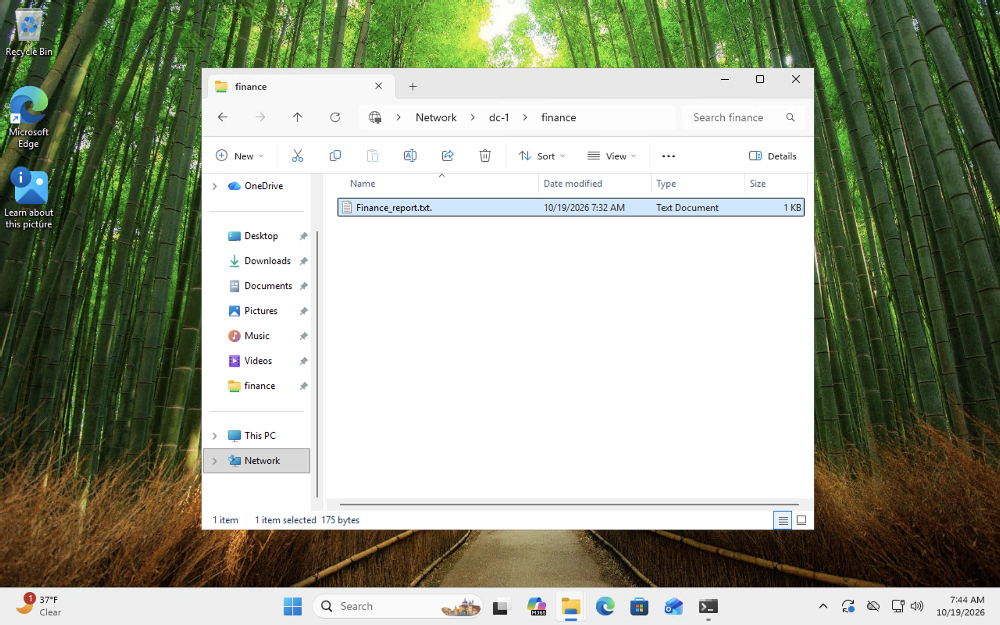
*Figure 12 — Finance folder after file-operation testing.*

### 6. Regression test: Read-only employee stays restricted
I verified that Marcus Johnson's read-only role still blocked saving modifications to the Finance report.

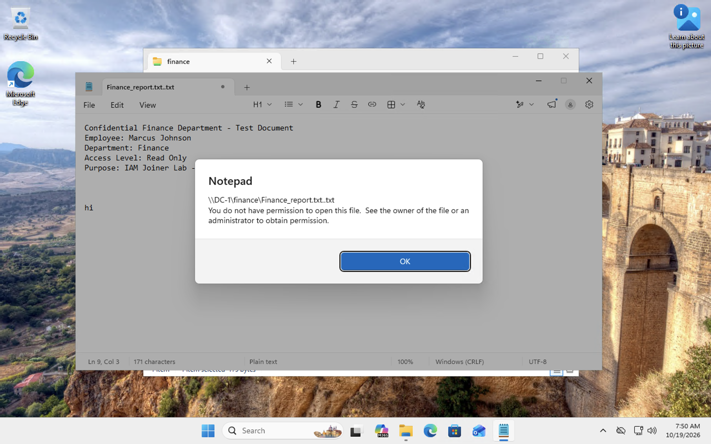
*Figure 13 — Marcus receives an access-denied message when attempting to save.*

## Validation Results
| Test | Observed result |
|---|---|
| Sarah's account and role reviewed | Confirmed |
| Sarah's Finance group membership inspected | Confirmed |
| SMB Read/Change configuration reviewed | Confirmed |
| Manager test file present in Finance share | Confirmed |
| Manager test file opened and edited | Confirmed |
| File deletion | Delete prompt shown; completion not independently established by the prompt |
| Marcus's read-only write restriction retained | **Denied as intended** |

## Security Principles Demonstrated
- **Mover lifecycle:** Reassess access when job duties change.
- **Role-based access control:** Use AD security groups rather than direct user permissions.
- **Least privilege:** Grant write access to the role that requires it while preserving read-only restrictions.
- **Defense in depth:** Review both NTFS and SMB share permissions.
- **Access regression testing:** Check that a change for one user does not broaden another user's permissions.

## Skills & Tools
Active Directory · ADUC · PowerShell · Windows Server · Windows client VM · SMB · NTFS · Security groups · RBAC · Access testing · Microsoft Azure VMs

## Evidence Directory
See [EVIDENCE-INDEX.md](EVIDENCE-INDEX.md) for all screenshots and their descriptions.

## Author
**Devin French** · CompTIA Security+  
[GitHub](https://github.com/devin-french)

---
*Portfolio homelab — not a production environment.*
